<p align="center">
  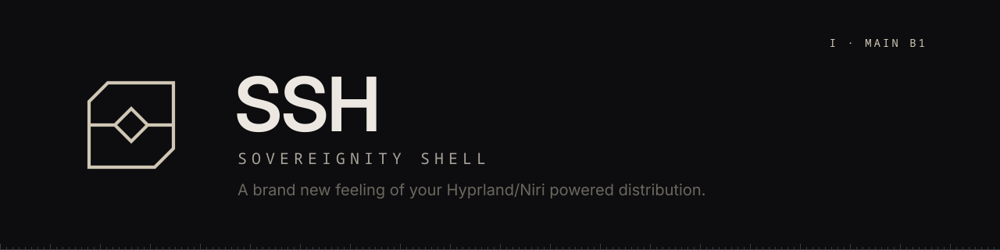
</p>

<p align="center">
  <b>A brand new feeling of your Hyprland/Niri powered distribution.</b>
</p>

<p align="center">
  <a href="https://github.com/ogjulius/SSH---Sovereignity-Shell/actions/workflows/ci.yml"></a>
  <a href="https://github.com/ogjulius/SSH---Sovereignity-Shell/actions/workflows/build-arch.yml"></a>
  <a href="https://github.com/ogjulius/SSH---Sovereignity-Shell/actions/workflows/build-fedora.yml"></a>
  <a href="https://github.com/ogjulius/SSH---Sovereignity-Shell/actions/workflows/build-nixos.yml"></a>
  <a href="LICENSE"></a>
</p>

<p align="center">
  <a href="#-what-makes-it-different">Features</a> ·
  <a href="#-gallery">Gallery</a> ·
  <a href="#-install">Install</a> ·
  <a href="docs/installation/COMPATIBILITY.md">Compatibility</a> ·
  <a href="docs/README.md">Documentation</a> ·
  <a href="#-contributing">Contributing</a>
</p>

---

**SSH — Sovereignity Shell** is an original desktop shell for **Hyprland** and
**Niri**, built on [Quickshell](https://quickshell.org) and Qt 6. It rests on one
idea: **your desktop is territory, not a list.** Workspaces are cells on a map
you can extend in every direction, name, group into collections and travel
with the keyboard. The bar, the hub, the overview and every panel speak that
same spatial language.

> [!NOTE]
> **Status: alpha (`0.1.0-alpha`, unreleased).** SSH runs daily on Hyprland and
> passes its runtime suite on Niri in CI. Read the honest
> [compatibility matrix](docs/installation/COMPATIBILITY.md) before installing.

## ◇ What makes it different

<table>
<tr>
<td width="50%" valign="top">

### Atlas — the Infinite Desktop
An unbounded 2D map of workspace cells (`A1`, `C2`, `−B−1`) grouped into
collections. Travel with **Super+Alt+arrows**, carry a window with
**Super+Alt+Shift+arrows**, drag windows between cells, name places. SSH keeps
the map and binds each cell to a real workspace, so your compositor's own
workspace keys keep working. On Hyprland, row 1 *is* workspaces 1–10.

</td>
<td width="50%" valign="top">

### Lens — Sovereign Space
A compass around where you stand: the current cell's windows in the centre,
the four neighbouring places on the cardinal points (travel without closing it),
session context in the corners, and **one intent line** that searches apps,
windows, named places and commands at once.

</td>
</tr>
<tr>
<td valign="top">

### Meridian
A flush instrument strip with a ruler-tick edge, your coordinate, a minimap of
the neighbourhood and the stops on your current row. No floating pill.

</td>
<td valign="top">

### One design language
Chamfered plates instead of rounded rectangles, hairlines, warm-silver accents
on obsidian (dark) or vellum (light), an original glyph set, figures in
monospace. Text contrast is unit-tested.

</td>
</tr>
<tr>
<td valign="top">

### Sovereignty
Never edits your compositor config, never geolocates, keeps notification text
in memory unless you opt in, refuses to overwrite a config it cannot parse.

</td>
<td valign="top">

### Light
Only the bar is resident; every panel is created on open and destroyed on
close. **~0.03 % idle CPU** and **+38 MiB** over a bare Quickshell bar —
[measured](docs/PERFORMANCE.md), not promised.

</td>
</tr>
</table>

Also included: a **launcher** with frecency · **Instruments** (Wi-Fi,
Bluetooth, audio devices, microphone, brightness, power profiles, battery) ·
the **Almanac** (calendar with ISO weeks, keyless weather, load meters, media) ·
**Signals** (notification daemon with actions, history and quiet mode) · OSD ·
a two-step power menu · a **Settings** window generated from the config schema.

## ◇ Gallery

Genuine captures of SSH running on Hyprland
([how they were made](assets/screenshots/README.md)).

<p align="center">
  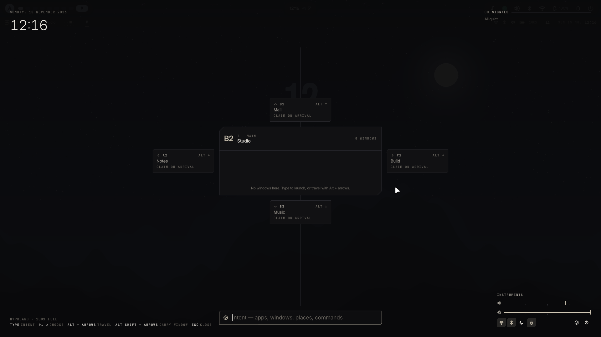
  <br><sub><b>Lens</b> — the current cell, its neighbours, and the intent line</sub>
</p>

<p align="center">
  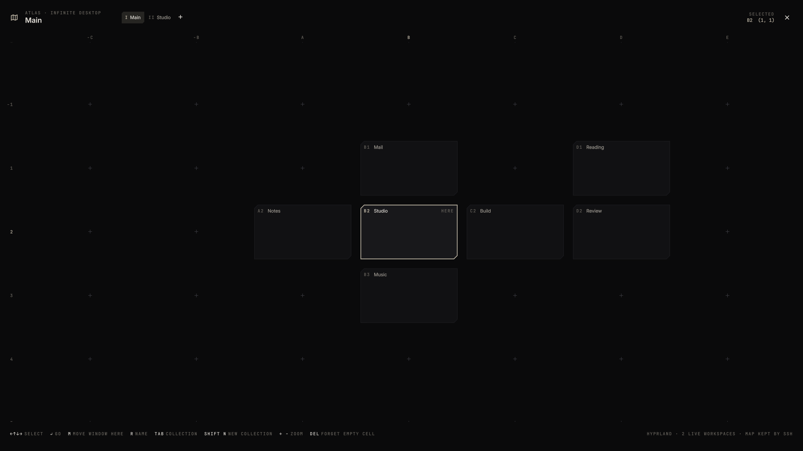
  <br><sub><b>Atlas</b> — named places on an open survey grid; collections as tabs</sub>
</p>

<p align="center">
  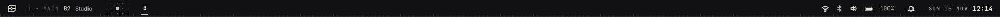
  <br><sub><b>Meridian</b> — coordinate, minimap, row stops, instruments, signals, time</sub>
</p>

<table>
<tr>
<td width="50%" align="center">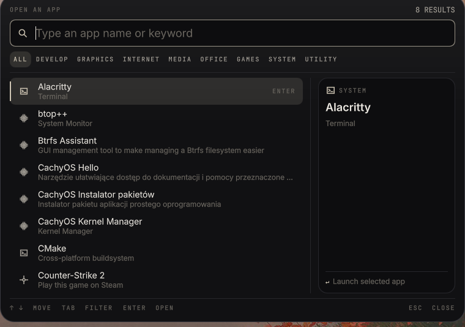<br><sub><b>Launcher</b></sub></td>
<td width="50%" align="center">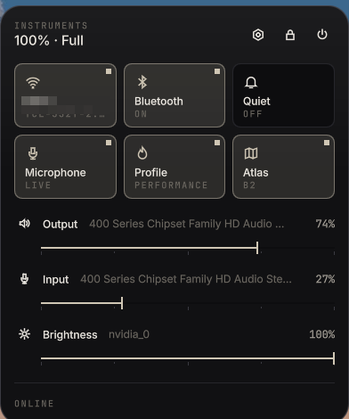<br><sub><b>Instruments</b> (network name pixelated)</sub></td>
</tr>
<tr>
<td align="center">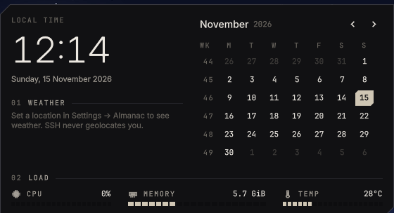<br><sub><b>Almanac</b></sub></td>
<td align="center">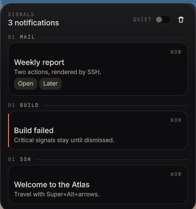<br><sub><b>Signals</b></sub></td>
</tr>
<tr>
<td align="center">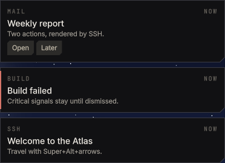<br><sub><b>Notification popups</b></sub></td>
<td align="center">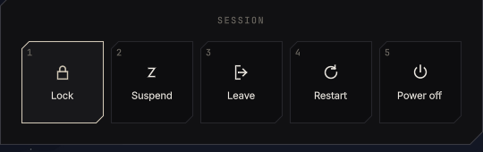<br><sub><b>Power menu</b></sub></td>
</tr>
</table>

<details>
<summary><b>Settings</b></summary>
<p align="center">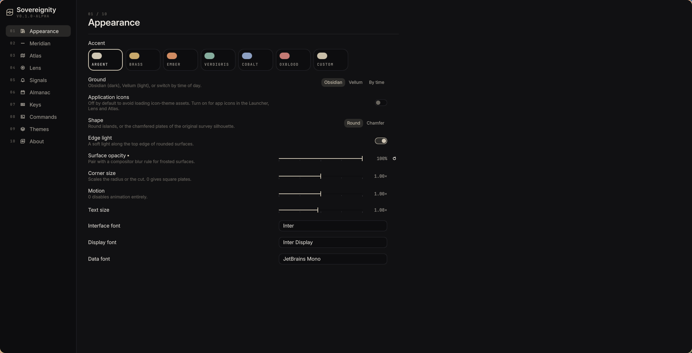</p>
</details>

<table>
<tr>
<td width="50%" align="center">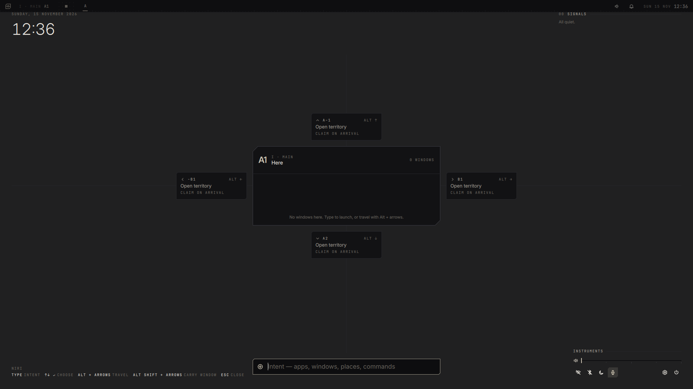<br><sub><b>Lens on Niri</b></sub></td>
<td width="50%" align="center">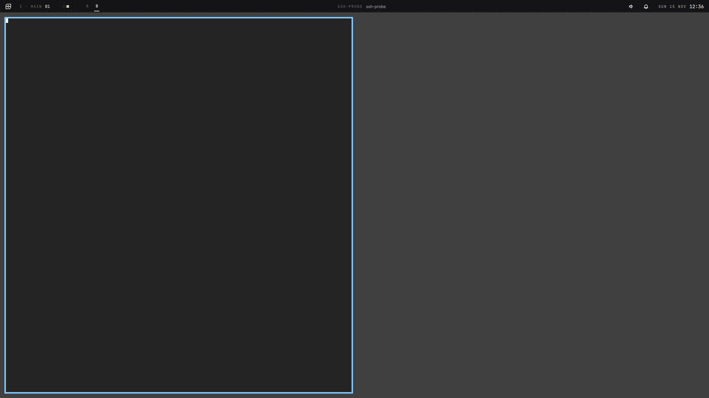<br><sub><b>Carry on Niri</b> — window moved to B1 by <code>atlas carry right</code></sub></td>
</tr>
</table>
<sub>Niri captures come from the CI runtime test: nested Niri 26.04, software-rendered, default backdrop. Not yet in the gallery: the <b>media</b> strip with a live player.</sub>

## ◇ Install

| Distribution | Support | Guide |
|---|---|---|
| Arch Linux | Official | [docs/installation/ARCH.md](docs/installation/ARCH.md) |
| CachyOS | Official | [docs/installation/CACHYOS.md](docs/installation/CACHYOS.md) |
| EndeavourOS | Official | [docs/installation/ENDEAVOUROS.md](docs/installation/ENDEAVOUROS.md) |
| Fedora Linux | Official | [docs/installation/FEDORA.md](docs/installation/FEDORA.md) |
| NixOS | Official | [docs/installation/NIXOS.md](docs/installation/NIXOS.md) |
| Void Linux | **Unofficial** (community) | [docs/installation/VOID.md](docs/installation/VOID.md) |

What "official" means and what has actually been verified on each:
[compatibility matrix](docs/installation/COMPATIBILITY.md).

**Quick start on Arch / CachyOS / EndeavourOS**

```sh
git clone https://github.com/ogjulius/SSH---Sovereignity-Shell.git
cd SSH---Sovereignity-Shell/packaging/arch && makepkg -si
ssh-shell keybinds hyprland      # or: hyprland-lua · niri — paste into your compositor config
```

**NixOS**

```nix
inputs.ssh-shell.url = "github:ogjulius/SSH---Sovereignity-Shell";
# modules = [ ssh-shell.nixosModules.default { programs.ssh-shell.enable = true; } ];
```

### Supported compositors

| Compositor | Backend | Verified |
|---|---|---|
| **Hyprland** (classic and Lua configs) | Quickshell's native Hyprland IPC | Live on real hardware (0.57.2, Lua config) |
| **Niri** | Niri's JSON event stream + `niri msg` | Runtime suite in CI (Niri 26.04, nested, software-rendered) |

Details: [docs/COMPOSITOR_SUPPORT.md](docs/COMPOSITOR_SUPPORT.md).

## ◇ Configure

Everything is in **Settings** (`ssh-shell settings open`): accents, grounds,
chamfer size, motion, fonts, bar layout, Atlas behaviour, notifications,
weather, commands and keys. Settings writes only your own choices to
`~/.config/ssh-shell/config.json`, validated option by option.

```sh
ssh-shell lens toggle              # every action is scriptable
ssh-shell atlas traverse left
ssh-shell panel toggle instruments
ssh-shell status                   # machine-readable state
```

[Configuration reference](docs/CONFIGURATION.md) ·
[Theming](docs/THEMING.md) · [Interaction model](docs/INTERACTION_MODEL.md)

## ◇ Under the hood

```
src/
  shell.qml        resident Meridian, lazily created surfaces, IPC
  configuration/   one schema declares every option (type, default, range)
  themes/          design tokens, palettes, original glyph set
  compositors/     one interface · hyprland/ · niri/ backends
  services/        PipeWire, NetworkManager, BlueZ, UPower, MPRIS, notifications, Atlas
  modules/         Meridian, Lens, Atlas, launcher, Instruments, Almanac, Signals, …
```

- **Architecture:** strict layering with no cycles; every surface is a pure
  content item in one shared window type. See [ARCHITECTURE.md](docs/ARCHITECTURE.md).
- **Performance philosophy:** resident means the bar, nothing else; no polling
  while idle; sampling only while something is looking; measure everything.
  See [PERFORMANCE.md](docs/PERFORMANCE.md).
- **Testing:** 239 unit assertions, Qt 6 lint, an offscreen load test, package
  install/uninstall on Arch, Fedora and Nix, and a live runtime suite inside a
  real Niri session. See [TESTING.md](docs/development/TESTING.md).

## ◇ Develop

```sh
git clone https://github.com/ogjulius/SSH---Sovereignity-Shell.git && cd SSH---Sovereignity-Shell
SSH_SHELL_NO_NOTIFICATIONS=1 SSH_SHELL_CONFIG=/tmp/ssh-dev.json qs -p src   # live-reloads on save
make test
```

[Development guide](docs/DEVELOPMENT.md) · [Testing](docs/development/TESTING.md) ·
[Release process](docs/development/RELEASE.md)

## ◇ Roadmap

Next: Niri on real hardware, distribution verification for CachyOS,
EndeavourOS, Fedora and NixOS desktops, multi-monitor and HiDPI passes. Later:
clipboard history in the Lens, per-collection wallpapers, a polkit agent, a
custom widget framework. Full list: [ROADMAP.md](docs/ROADMAP.md) ·
current state: [STATUS.md](docs/STATUS.md).

## ◇ Contributing

Contributions are welcome. Read [CONTRIBUTING.md](CONTRIBUTING.md) and the
[Code of Conduct](CODE_OF_CONDUCT.md); get help via [SUPPORT.md](SUPPORT.md);
report vulnerabilities privately per [SECURITY.md](SECURITY.md).

## ◇ License

[GPL-3.0-or-later](LICENSE). SSH is an independent project and is not
affiliated with Quickshell, Hyprland or Niri.

<p align="center">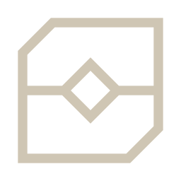</p>
